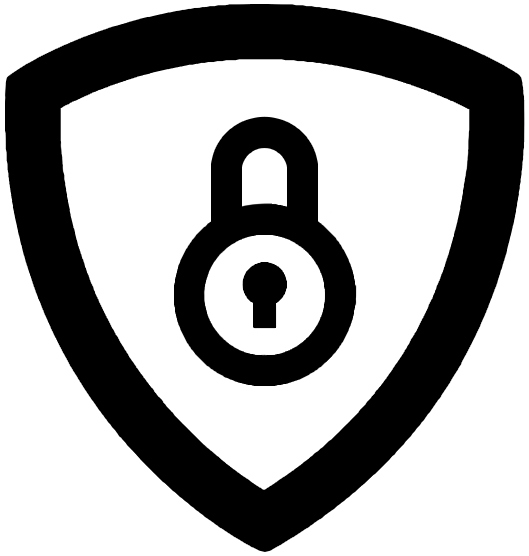

<picture>
  <source media="(prefers-color-scheme: dark)" srcset="https://raw.githubusercontent.com/Nimda-Security/.github/main/profile/logo-dark.png">
  
</picture>

# NIMDA Security

**공주대학교 정보보안 동아리** 
웹 해킹 · 시스템 보안 · 알고리즘을 함께 공부하고, 직접 만든 서비스로 동아리를 운영합니다.

[nimda.kr](https://nimda.kr) · [about.nimda.kr](https://about.nimda.kr) · [신입 부원 지원](https://moaform.com/q/8e13lE)

---

## Activities

<table>
<tr>
<td width="33%" valign="top"><b>학습</b> C · C++ · JavaScript 멘토링 웹 개발 스터디 웹 해킹 · 시스템 보안 · CTF 기초</td>
<td width="33%" valign="top"><b>도전</b> ICPC · UCPC 참가 교내 해커톤 자체 대회 님다콘 개최 (2025.11 제1회)</td>
<td width="33%" valign="top"><b>응용</b> 동아리 웹 플랫폼 개발 · 운영 보안 문제 풀이 · 취약점 분석 실습</td>
</tr>
</table>

## Projects

| 프로젝트 | 설명 | 저장소 |
| --- | --- | --- |
| **NIMDA Web** | 커뮤니티 · 회원 · 활동 보상을 담은 동아리 플랫폼 ([nimda.kr](https://nimda.kr)) | [Nimda-web-frontend](https://github.com/Nimda-Security/Nimda-web-frontend) · 백엔드 비공개 |
| **NIMDA Landing** | 동아리 소개 · 신입 부원 모집 ([about.nimda.kr](https://about.nimda.kr)) | [Nimda-web-landing](https://github.com/Nimda-Security/Nimda-web-landing) |
| **NIMDACON** | 자체 대회 채점 · CTF 인프라 | 비공개 |
| **Nimda** (보관) | 2025.09 – 2026.10 통합 저장소 이력 | [Nimda](https://github.com/Nimda-Security/Nimda) |

## Awards

- **2024** 프로보노 ICT멘토링 공모전 입선
- **2020** K-사이버 시큐리티 챌린지 충청권 지역예선 1등

## Contact

- 이메일 — nimda0410@gmail.com
- 동아리방 — 충청남도 천안시 서북구 천안대로 1223-24 학생회관 305호
- 신입 부원 지원 — [about.nimda.kr](https://about.nimda.kr)
